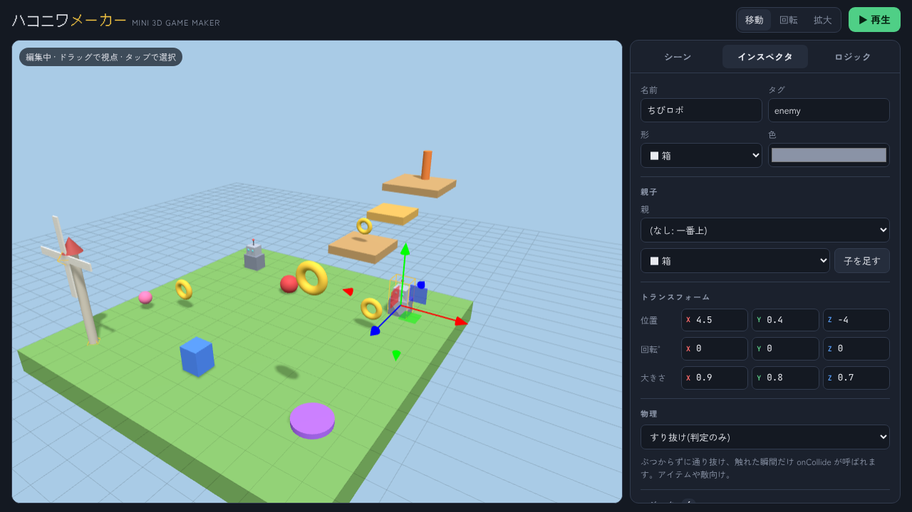
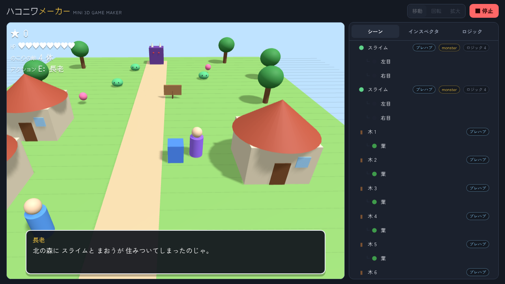
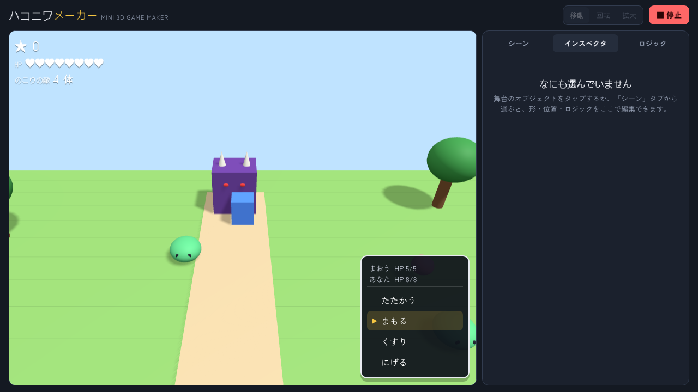
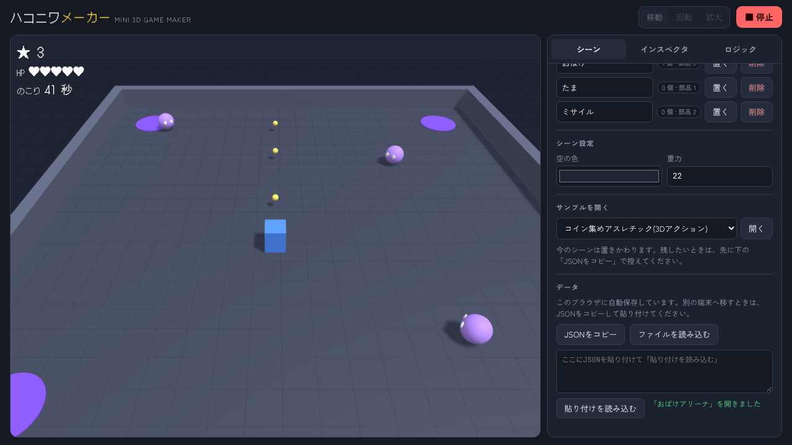

# ハコニワメーカー

ブラウザだけで動く、ミニ3Dゲームエンジンです。

**▶ 遊んでみる: https://salty-en-jp.github.io/hakoniwa-maker/**

箱や球を置いて「ロジックアセット」を付けると、その場で遊べるゲームになります。ロジックは用意された部品を組み合わせるだけでも使えますし、中身の JavaScript を書き換えて自由に作ることもできます。

最終的には、ジャンルに縛られずにあらゆるアセットを混ぜて組み合わせられる「カオスゲームエンジン」を目指しています。ちゃんと作れば、ちゃんとゲームになるものです。

| エディタ | ADV(会話) |
|---|---|
|  |  |
| **ターン制バトル** | **シューター** |
|  |  |

## こだわり

このプロジェクトは、人間(企画・方向づけ)と Claude(設計・実装・検証)の2人で作っています。どちらのこだわりも、ここに残しておきます。

### 企画者のこだわり

- **ロジックそのものをアセットにする。** 見た目だけでなく「動き」や「ルール」も部品として置き、パラメータをいじるだけでも、コードを書き換えても変えられるようにする(部品式とコード式の両方 = A+B 方式)
- **ジャンルに縛られない。** アクション、ターン制、ソウルライク、ロボ、ノベル……どのジャンルの部品も混ぜて使える「カオスゲームエンジン」にする
- **でも、ちゃんとゲームになる。** 混ぜただけで壊れるおもちゃではなく、まじめに作れば遊べる1本になること
- **最初から細かい部品がそろっている。** 車ならステアリングもエアロも最初から付いてきて、置いた瞬間に遊べる。ミサイルを撃てば煙や爆発までつながる、そんな厚みを目指す
- **64 風の箱庭。** カクカクしたローポリの世界で、いきなりレースが始まるような気軽さ
- **全部日本語で。** 画面も説明も、日本語で読めること
- **作った理由を残す。** 何かを足すたびに、その理由とこだわりを書き残していく(下の「開発の記録」)

### 実装者(Claude)のこだわり

- **部品どうしは「合図」でつなぐ。** 部品は相手の中身を知らず、`damage` や `interact` のような決まった名前の合図(共通語)だけでやり取りする。ジャンルの違う部品を混ぜても壊れないのは、この1点にかかっている
- **中身を隠さない。** 組み込みの部品も、ロジック タブでコードを開いて読めるし書き換えられる。エンジンが特別扱いしている部品はない
- **インストールもビルドも要らない。** ブラウザで開けばすぐ動く。ファイルを分けても、ビルドの手順は増やさない
- **エンジン本体は画面を知らない。** `src/core/` はエディタに頼らずに動く。いつか「遊ぶだけのページ」を作るときに、そのまま使えるように
- **やさしい言葉で名前を付ける。** 「メッセージバス」ではなく「合図」、「ヒエラルキー」ではなく「親子」。画面に出る言葉は、触る人が分かる言葉にする
- **作ったものを壊さない。** 保存したデータは、エンジンが育っても読み込める。新しい部品は自動で足し、自分で消した部品は勝手に戻さない。削除は2回押しで確認する
- **毎回動くものを足す。** 一度に全部作らず、1回ごとに遊べる状態で区切る。そのたびに実際のブラウザで遊んで確かめ、公開ページでももう一度確かめてから「できた」と言う
- **箱と球だけで、それらしく。** 3D モデルのファイルを使わず、基本の形を親子で組み合わせて作る。軽いまま、64 風の手ざわりを出せる

## 開発の記録

新しいものから並べています。

### 2026-11-06 ポートフォリオとして整える

- **やったこと:** README の冒頭に公開ページへのリンクとスクリーンショットを置き、2人の「こだわり」とこの「開発の記録」を書いた。作業ルールを CLAUDE.md にまとめた
- **理由:** 「ポートフォリオにできそうなら、私とあなたのこだわりを README に書き込んでおいて欲しい。何か追加するごとに、その理由とこだわりを書き込んでいこう」
- **こだわり:** 記録は「やったこと・理由・こだわり」の3行にそろえ、理由にはなるべく企画者の言葉をそのまま残す。次に誰が(どの会話の Claude が)作業しても同じ書き方で続くよう、ルールをリポジトリの中に置いた

### 2026-11-06 ジャンルを増やす: ADV、ターン制RPG、シューター

- **やったこと:** 会話ウィンドウ・選択肢と「待てるスクリプト」(`await game.ui.say(...)`)を作り、その上に ADV・ターン制RPG・シューター用の部品 10 個と、サンプル「はじまりの村」「おばけアリーナ」を足した
- **理由:** 「ジャンル増やしてこー」。ただ、ノベルやターン制は「セリフを読み終わるまで待つ」が書けないと作れない。先に土台を作ってからジャンルを乗せた
- **こだわり:** バトルも会話も、同じ HP 部品・同じ合図を使う。アクションの敵にそのままターン制バトルを付けられるのは、ジャンルごとに別の仕組みを作らなかったから。サンプルの説明画面は、組み込みではなく「自分で書くロジック」の見本として書いた

### 2026-11-06 親子関係とプレハブ

- **やったこと:** オブジェクトを親子にできるようにし、親子でまとめたものを「型」(プレハブ)として何個でも置けるようにした。サンプルに「ちびロボ」と「風車」を追加
- **理由:** 「車にステアリングやエアロが付いてくる」ような、細かい部品の集まりを1つのアセットとして扱うため
- **こだわり:** 置いたものは自由にいじれて、「プレハブに反映」で全部がそろう。差分の管理を複雑にせず、「直して、配る」だけにした。見えない「空」のまとめ役を用意して、親の大きさで子が歪む問題を避けられるようにした

### 2026-11-06 合図の仕組み

- **やったこと:** ロジックどうしが `self.on` / `other.send` で合図を送り合えるようにし、HP・ダメージ・回復・踏みつけの部品を足した
- **理由:** カオスエンジンの背骨だから。親子やプレハブより先に作った
- **こだわり:** 合図の名前と中身を「共通語」として [docs/messages.md](docs/messages.md) に決めた。倒れ方を変えたければ「やられたら消える」を差し替えるだけで、他の部品は一切触らなくていい

### 2026-11-06 GitHub で公開し、ファイルを分ける

- **やったこと:** 1ファイルだった試作を、エンジン本体・部品・サンプル・エディタに分けた。GitHub Pages で公開
- **理由:** これから大きくしていくため。1ファイルのままでは数千行で手に負えなくなる
- **こだわり:** 分けてもビルドは要らないまま。エディタのパネルどうしは直接呼ばず、合図でつなぐ(エンジンの「合図」と同じ考え方を、エディタの中でも使った)

### 2026-11-05 試作

- **やったこと:** 3D エディタ、ロジックアセット(部品式 + コード式)、簡易物理、コイン集めのサンプル
- **理由:** 「3D ゲームメーカーみたいなもの、作れる? ロジックをアセットにして自由にいじれるような」
- **こだわり:** 部品式だけでは物足りなく、コード式だけでは手軽さが消える。両方を同じ「ロジックアセット」として扱い、組み込みの部品もコードを開けば読めるようにした

## ドキュメント

- 構想とアセット一覧: [docs/ideas.md](docs/ideas.md)
- 開発の計画: [docs/roadmap.md](docs/roadmap.md)
- ジャンルキットとサンプル: [docs/genres.md](docs/genres.md)
- 合図と共通語: [docs/messages.md](docs/messages.md)
- 親子関係とプレハブ: [docs/prefabs.md](docs/prefabs.md)
- ファイル構成: [docs/architecture.md](docs/architecture.md)

## 動かし方

ES モジュールを使っているので、ファイルを直接開くのではなく、簡単なサーバーを立てて開いてください。インストールやビルドは要りません。

```sh
python3 -m http.server 8000
# → http://localhost:8000 を開く
```

three.js と Web フォントは CDN から読み込むので、ネット接続が必要です。

## サンプル

「シーン」タブの「サンプルを開く」から、遊べるサンプルを開けます。

| サンプル | ジャンル | 中身 |
|---|---|---|
| コイン集めアスレチック | 3Dアクション | コインを集めてゴール。敵は踏んで倒す。ちびロボと風車はプレハブ |
| はじまりの村 | ADV + ターン制RPG | 村人に話しかけ、森のスライムとまおうをコマンドバトルで倒す |
| おばけアリーナ | シューター / サバイバル | わいてくるおばけを弾とホーミングミサイルで倒し、45 秒生き残る |

## 画面の構成

| 場所 | できること |
|---|---|
| 上のバー | ギズモの切り替え(移動 / 回転 / 拡大)、▶ 再生と ■ 停止 |
| 舞台 | ドラッグで視点を回し、タップで選択し、矢印をつまんで動かす |
| シーン タブ | 形の追加、オブジェクト一覧、空の色と重力、保存と読み込み |
| インスペクタ タブ | 名前、タグ、形、色、位置、回転、大きさ、物理の種類、ロジックの付け外しと調整 |
| ロジック タブ | ロジックアセットの一覧、コードとパラメータの編集、新規作成 |

### 操作

- 編集中: `Delete` で削除、`Ctrl/⌘ + D` で複製
- 再生中: 矢印キーか WASD で移動、`Space` でジャンプ、`E` で話す、`J` で撃つ、`K` でミサイル、`Esc` で停止
- 会話は `Space` / `Enter` / クリックで送り、選択肢は ↑↓ で選んで `Enter`
- スマホでは、再生中に十字ボタンと「ジャンプ / 決定」「はなす」「うつ」「ミサイル」ボタンが出ます

## オブジェクト

**形**: 箱、球、円柱、円錐、リング、空(見えないまとめ役)

**親子**: インスペクタの「親」で、他のオブジェクトの子にできます。子は親と一緒に動き、回り、消えます。位置・回転・大きさは親から見た値です。

**プレハブ**: 親子でまとめたものを型として保存し、何個でも置けます。1つを直して「プレハブに反映」すると、全部がそろいます。サンプルの「ちびロボ」と「風車」がプレハブです。

**物理の種類**

| 種類 | 動き |
|---|---|
| なし(飾り) | 見た目だけで、当たり判定もありません |
| 固定(床・壁) | 動きません。ロジックで動かすと「動く床」になり、乗っているものを運びます |
| 動く(重力あり) | 重力で落ち、固定のものにぶつかって止まります。プレイヤー向け |
| すり抜け(判定のみ) | ぶつからずに通り抜け、触れた瞬間だけ `onCollide` が呼ばれます。アイテムや敵向け |

## 組み込みロジックアセット

| 名前 | 内容 |
|---|---|
| プレイヤー操作 | 矢印キー / WASD で移動、スペースでジャンプ |
| カメラ追従 | カメラが後ろ上から追いかける |
| 回転 | 回り続ける(回す軸を選べる) |
| 往復移動 | 軸に沿って行ったり来たりする |
| 拾えるアイテム | 触れられたら点数を足して消える |
| ゴール | 必要な点数があればクリア |
| 触れたらアウト | プレイヤーが触れたらゲームオーバー |
| 落下でアウト | 一定の高さより下に落ちたらゲームオーバー |
| ジャンプ台 | 乗ったものを跳ね上げる |
| HP | `damage` で減り、`heal` で増える。0 になると自分に `died` を送る。HUD にハートを出せる |
| 触れたらダメージ | 相手に `damage` を送る。上から踏まれたら逆に自分が `damage` を受ける |
| 回復アイテム | 触れられたら `heal` を送って消える |
| やられたら消える | `died` を受けたら点数を足して消える |
| やられたらゲームオーバー | `died` を受けたらゲームオーバー |

| 調べる・話す | 近くの話しかけられるものに E キーで `interact` を送る |
| 会話 | `interact` を受けたら会話ウィンドウでセリフを出す |
| ターン制バトル | 触れると(話しかけると)コマンドバトルが始まる |
| 弾を撃つ | キーで、名前で指定したプレハブを向いている方向に出す |
| まっすぐ飛ぶ | 向いている方向に進む |
| 追いかける | 一番近い `target` タグに向かう(敵の追跡、ホーミング) |
| 時間で消える | 決まった秒数で消える |
| 出現装置 | 一定時間ごとにプレハブを出す |
| 制限時間 | 残り時間を表示し、0 で勝ちか負け |
| 全滅でクリア | 指定したタグが全部いなくなったらクリア |

HP から下の部品は合図でつながっていて、組み合わせ方を変えるだけで振る舞いが変わります。サンプルステージでは、敵を横から触ると HP が減り、上から踏むと倒せます。

どれもロジック タブでコードを見たり、書き換えたりできます。

## ロジックの書き方

ロジックアセットの中身は、オブジェクトを返す JavaScript です。フックは `async` にでき、`await` で待ちながら書けます。`return` の外に書いた変数は、そのオブジェクト専用の記憶になります。

```js
let elapsed = 0;
const baseY = self.position.y;

return {
  start() {
    // 再生開始時に1回だけ
  },
  update(dt) {
    // 毎フレーム。dt は前のフレームからの秒数
    elapsed += dt;
    self.position.y = baseY + Math.sin(elapsed * params.speed) * params.height;
  },
  onCollide(other) {
    // 何かに触れた瞬間。other.tag で相手を見分ける
  }
};
```

ロジック タブで追加したパラメータは、インスペクタに調整欄として出てきます。種類は数値・文字・長い文字(複数行)・ON/OFF です。コードからは `params.名前` で読めます。

### `self`(このオブジェクト)

| 名前 | 内容 |
|---|---|
| `position` / `rotation` / `scale` | `.x .y .z` で読み書き(回転はラジアン) |
| `velocity` | 速度。物理が「動く」のとき有効 |
| `grounded` | 何かの上に立っているか |
| `name` / `tag` | 名前とタグ |
| `startPosition` | 再生開始時の位置 |
| `data` | 同じオブジェクトのロジックどうしで共有するメモ(HP は `data.hp` に今の値を書く) |
| `listens('名前')` | その合図を受け取るロジックが付いているか |
| `setColor('#ff0000')` | 色を変える |
| `destroy()` | 消える(子も一緒に) |
| `parent` / `children` | 親の `self`、子の `self` の配列 |
| `findChild('名前')` | 子孫から名前で探す |
| `worldPosition()` | 親子の影響を足した本当の位置 |
| `on('名前', (data, from) => …)` | 合図を受け取る |
| `send('名前', data, from)` | このオブジェクトに合図を送る。他のオブジェクトへは `other.send(...)` |

### `game`

| 名前 | 内容 |
|---|---|
| `key('ArrowUp')` | 押している間 `true`。`KeyA`〜`KeyZ`、`Space` なども |
| `pressed('Space')` | 押した瞬間だけ `true` |
| `score` / `addScore(n)` | 点数 |
| `message('文字', 秒)` | 画面に表示 |
| `hud('名前', '文字')` | 左上に1行表示し続ける。`null` で消す |
| `broadcast('名前', data, 'タグ')` | 全員(タグ指定ならその全員)に合図を送る |
| `win('文字')` / `lose('文字')` | クリア / ゲームオーバー |
| `find('名前')` | 名前で他のオブジェクトを探す |
| `findAll('タグ')` | タグで全部探す(配列) |
| `spawn('名前', {x, y, z})` | プレハブかオブジェクトを名前で出す(子もまとめて) |
| `time` / `camera` / `log(...)` | 経過秒、カメラ、ログ表示 |
| `await wait(秒)` | 待つ |
| `await ui.say('名前', 'セリフ')` | 会話ウィンドウを出し、送られるまで待つ |
| `await ui.choose(['はい', 'いいえ'], '見出し')` | 選択肢を出し、選ばれた番号を返す |
| `ui.busy` | 会話や選択肢を出しているか(出している間は `key` / `pressed` が届かない) |
| `pause()` / `resume()` | 世界(update・物理・接触)を止める・動かす。会話と `wait` は動く |
| `nearest(self, { tag, maxDist, listens })` | 一番近いものを探す |

`THREE` で three.js 本体(`Vector3` など)も使えます。

合図の詳しい使い方と、`damage` などの共通語の一覧は [docs/messages.md](docs/messages.md) にあります。

## 保存

作ったものはブラウザに自動保存されます。シーン タブから JSON をコピーしたりファイルを読み込んだりして、別の端末にも持っていけます。

## 今の制限

- 当たり判定は回転しない箱で近似しています。回転したものや球の判定は大まかです
- 再生中の入力はキーボードと画面ボタンだけです(マウス入力はまだありません)
- 音、複数シーン、メニューやインベントリなどの画面部品、3Dモデルの読み込みはまだありません

## 使っているもの

- [three.js](https://threejs.org/) r160(OrbitControls、TransformControls)
- Google Fonts: DotGothic16、Zen Kaku Gothic New、JetBrains Mono
